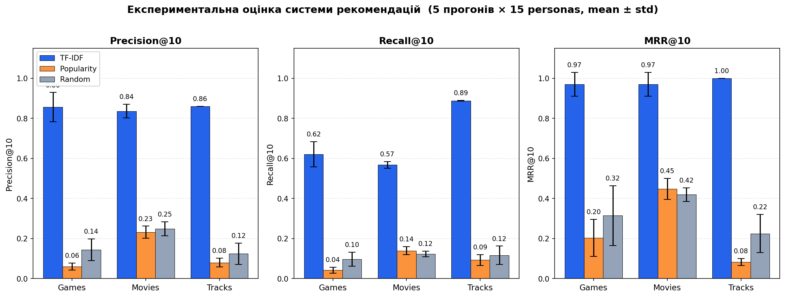
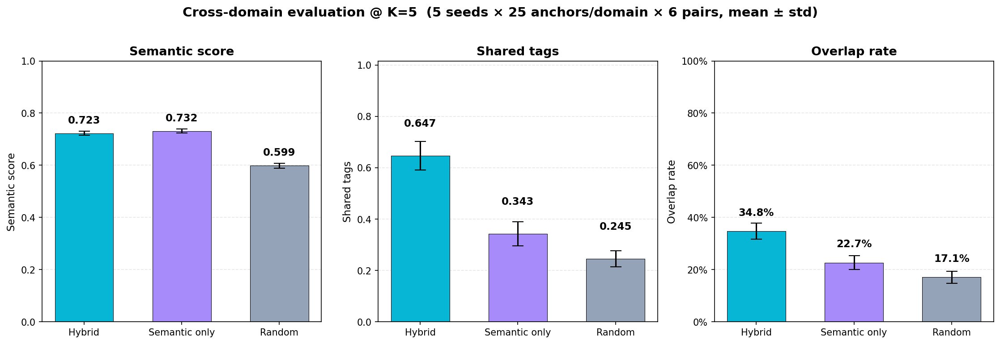

# Multimedia Recommendation System

Diploma project: a web platform that recommends **music, movies and games** from a single taste profile. Users like items in any domain, get personalised recommendations inside each domain, discover cross-domain matches ("if you like this album, try this game"), and compare tastes with friends using AI-generated insights.

## Features

- **Catalog** of tracks, movies and games with genre filters, sorting and pagination
- **Likes** — one taste profile across all three domains
- **Single-domain recommendations** — TF-IDF over genres/tags + cosine similarity, cached per user and invalidated on every like
- **Cross-domain recommendations** — hybrid ranking: semantic similarity of item embeddings (MiniLM) plus a shared-tag bonus, with short AI explanations for each pair
- **Three-tier search** — substring match → semantic search (sentence-transformers + pgvector) → natural-language AI search (Claude Haiku)
- **Social** — friend requests, public profiles, "friends who liked this", social links, AI taste-compatibility comparison between two users
- **Google sign-in** via Firebase Authentication, light/dark theme

## Tech stack

| Layer | Technologies |
|---|---|
| Frontend | Astro, React, TypeScript, Firebase Auth |
| Backend | Python, FastAPI, PostgreSQL + pgvector, psycopg2 |
| ML / AI | scikit-learn (TF-IDF, cosine similarity), sentence-transformers `all-MiniLM-L6-v2`, Anthropic Claude Haiku |
| Data sources | Last.fm (music), TMDB (movies), RAWG (games) |

## Architecture

```
frontend/ (Astro + React)  ──HTTP──>  backend/ (FastAPI)  ──>  PostgreSQL + pgvector
                                          │
                                          ├── routers/        content, likes, users, friends,
                                          │                   search, recommendations, cross, compare
                                          ├── evaluation/     offline evaluation + charts
                                          └── sandbox/        data seeding, normalisation, load & security tests
```

## Evaluation

### Single-domain (TF-IDF)

15 synthetic users × 5 random seeds; each user likes 7 items of a target genre, the rest of that genre is the ground truth.

| Method | Precision@5 | Recall@10 | MRR@10 |
|---|---|---|---|
| **TF-IDF (ours)** | **0.93** | **0.69** | **0.98** |
| Popularity | 0.10 | 0.09 | 0.24 |
| Random | 0.17 | 0.11 | 0.32 |



### Cross-domain (hybrid)

25 anchors per domain, 6 domain pairs, 5 seeds. Hybrid ranking keeps semantic quality on par with pure embeddings, while roughly doubling the number of shared tags in top-1 results (0.79 vs 0.38) and beating random by a wide margin.

| Method (top-5) | Semantic score | Shared tags | Tag overlap |
|---|---|---|---|
| **Hybrid (ours)** | 0.72 | **0.65** | **0.35** |
| Semantic only | 0.73 | 0.34 | 0.23 |
| Random | 0.60 | 0.25 | 0.17 |



## Getting started

### Requirements

- Python 3.11+
- Node.js 20+
- PostgreSQL 15+ with the `pgvector` extension
- API keys: Last.fm, TMDB, RAWG, Anthropic; a Firebase project with Google sign-in enabled

### Backend

```bash
cd backend
python -m venv venv
venv\Scripts\activate          # Windows; use `source venv/bin/activate` on macOS/Linux
pip install -r requirements.txt
cp .env.example .env           # fill in your keys
python sandbox/seed_tracks.py  # also seed_movies.py, seed_games.py
python -m uvicorn main:app --reload
```

API runs at `http://localhost:8000`, interactive docs at `/docs`.

### Frontend

```bash
cd frontend
npm install
cp .env.example .env           # Firebase web config
npm run dev
```

The app opens at `http://localhost:4321`.

## Project structure

| Path | Description |
|---|---|
| `backend/main.py` | FastAPI app, CORS, router registration, embedding model warm-up |
| `backend/routers/recommendations.py` | Single-domain TF-IDF recommender |
| `backend/routers/cross.py` | Cross-domain hybrid recommender + AI explanations |
| `backend/routers/search.py` | Three-tier search |
| `backend/routers/compare.py` | AI taste comparison between two users |
| `backend/evaluation/` | Offline evaluation scripts, results (`results.json`) and charts |
| `backend/sandbox/` | Data seeding/normalisation, latency, load and security tests |
| `frontend/src/pages/` | Astro pages: catalog, details, discover, search, profile, friends |
| `frontend/src/components/` | React UI components |
